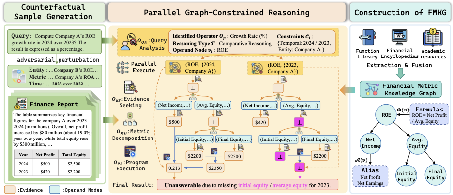

# GBFR

Official resources for [**"Achieving Multi-Hop Calculation and Safe Abstention in Financial Numerical Reasoning by Metric Graph Constrained LLMs"**](https://aclanthology.org/2026.acl-long.1273/).

## Paper Overview



Large language models (LLMs) often struggle with financial numerical reasoning due to two fundamental challenges: **evidence ambiguity** (e.g., missing values, aliases) and **structural complexity** (recursive metric dependencies). Existing approaches rely on soft prompting or retrieval, which do not enforce rigorous logical constraints.

We propose **GBFR (Graph-Bounded Financial Reasoning)**, a neuro-symbolic framework that combines the semantic flexibility of LLMs with the structural rigor of a **Financial Metric Knowledge Graph (FMKG)**. GBFR uses a parallel graph-constrained reasoning algorithm with four atomic operators to explore multiple derivation paths simultaneously, perform cross‑path verification, and **safely abstain** when evidence is insufficient.

## Requirements

### Software

- Python 3.9 or later
- Neo4j with Bolt enabled
- An OpenAI-compatible chat completion API endpoint

Neo4j is required when using the financial metric knowledge graph. By default, the code expects:

```text
bolt://localhost:7687
```

The Neo4j user, password, and URI can be passed as command-line arguments.

### Python Dependencies

Install dependencies from the project root:

```bash
pip install -r requirements.txt
```

The current dependency list is:

```text
langgraph
langchain-core
openai
pydantic
py2neo
PyYAML
tqdm
```

## LLM Configuration

Edit `llm_config.yaml` before running the reasoning pipeline:

```yaml
llm_config:
  openai:
    model_name: your-model-name
    url: https://your-openai-compatible-endpoint/v1
    api_key: your-api-key
```

The framework uses the OpenAI Python SDK and supports OpenAI-compatible endpoints through `base_url`.

## Financial Metric Knowledge Base

The **Financial Metric Knowledge Base** is the foundational data source for constructing the Financial Metric Knowledge Graph (FMKG). It is located at:

```text
knowledge_base/term_en_final.json
```

This dataset contains **7,521** financial terms with standardized definitions, multilingual aliases, calculation formulas, executable Python code, dependency concepts, and domain categories.

### Field Attributes

```json
{
  "term_en": {
    "name": "[String] Standardized English name",
    "aliases": {
      "chinese": "[List] Chinese synonyms",
      "english": "[List] English synonyms",
      "abbreviations": "[List] Common abbreviations"
    }
  },
  "definition_en": "[String] Semantic definition of the metric",
  "formula_en": "[List] Valid calculation formulas",
  "code": "[List] Executable Python functions corresponding to formulas",
  "related_concepts_en": "[List] Dependencies required for calculation",
  "category_en": "[List] Domain tags"
}
```

### Data Example

```json
{
  "term_en": {
    "name": "Cost of Sales",
    "aliases": {
      "chinese": ["销售成本", "营业成本", "销货成本"],
      "english": ["Cost of Goods Sold", "Cost of Products Sold", "Cost of sales", "Cost of Sales"],
      "abbreviations": ["COGS", "COPS"]
    }
  },
  "definition_en": "Cost of sales refers to the production cost of goods sold or the service cost of services provided, as well as other business costs of sales.",
  "formula_en": [
    "Cost of Sales = Beginning Inventory Cost + Purchases During the Period - Ending Inventory Cost",
    "Cost of Sales = Net Sales × (1 - Gross Profit Margin)",
    "Cost of Sales = Production Cost of Inventory Goods"
  ],
  "code": [
    "def sales_cost_v1(beginning_inventory_cost, purchase_cost, ending_inventory_cost):\n    return beginning_inventory_cost + purchase_cost - ending_inventory_cost",
    "def sales_cost_v2(net_sales, gross_profit_rate):\n    return net_sales * (1 - gross_profit_rate)",
    "def sales_cost_v3(cost_of_inventory):\n    return cost_of_inventory"
  ],
  "related_concepts_en": [
    {"concept": "Beginning Inventory Cost", "relation": "Calculation"},
    {"concept": "Purchases During the Period", "relation": "Calculation"},
    {"concept": "Ending Inventory Cost", "relation": "Calculation"}
  ],
  "category_en": ["Accounting", "Corporate", "Cost Accounting"]
}
```

## Import Data Into Neo4j

Use `utils/graph.py` to import `knowledge_base/term_en_final.json` into Neo4j.

### Default Import

```bash
python utils/graph.py \
  --uri bolt://localhost:7687 \
  --user neo4j \
  --password your-neo4j-password
```

By default, the script reads:

```text
knowledge_base/term_en_final.json
```

### Clear Existing Imported Graph Before Import

If you want to remove previously imported English FMKG nodes and relationships first:

```bash
python utils/graph.py \
  --uri bolt://localhost:7687 \
  --user neo4j \
  --password your-neo4j-password \
  --clear
```

The import script creates English graph labels and properties used by the reasoning code:

```text
FinanceTerm_en
FinanceConcept_en
FinanceCategory_en
CALCULATED_BY_EN
BELONGS_TO_EN
name_en
definition_en
formulas_en
aliases_zh_en
aliases_en_en
aliases_abbr_en
```

You can also configure Neo4j through environment variables:

```bash
export NEO4J_URI=bolt://localhost:7687
export NEO4J_USER=neo4j
export NEO4J_PASSWORD=your-neo4j-password
python utils/graph.py
```

## Run The Reasoning Pipeline

After installing dependencies, configuring `llm_config.yaml`, and importing the knowledge base into Neo4j, run:

```bash
python main.py \
  --dataset_name FinQA \
  --model_name openai \
  --db_uri bolt://localhost:7687 \
  --db_user neo4j \
  --db_password your-neo4j-password \
  --lang en
```

Supported dataset names in `main.py`:

```text
CFBenchmark
FinanceReasoning
FinQA
TAT-QA
```

The script reads examples from `data/<dataset_name>/`, runs the GBFR workflow, and writes logs/results under `logs/`.

## Run A Single Query Programmatically

You can also call the workflow directly:

```python
from agents.workflow import run_workflow

query = "What should Toft report as earnings per share for the year? Answer to the nearest cent."
context = """
Toft Co. had 120000 shares of common stock outstanding at January 1.
On April 1 it issued 40000 additional shares of common stock.
Outstanding all year were 10000 shares of nonconvertible preferred stock
on which a dividend of $5 per share was declared during the year.
Net income for the year was $480000.
"""

result = run_workflow(
    query=query,
    context=context,
    model_name="openai",
    lang="en",
    db_uri="bolt://localhost:7687",
    db_user="neo4j",
    db_password="your-neo4j-password",
)

print(result)
```

## Project Structure

```text
agents/          LangGraph workflow states, nodes, edges, and orchestration
operators/       Question analysis, evidence seeking, decomposition, and execution operators
utils/           LLM client, logging utilities, and Neo4j import script
knowledge_base/  Financial Metric Knowledge Base JSON
data/            Benchmark datasets
main.py          Dataset-level execution entry point
llm_config.yaml  LLM endpoint configuration
```
## Citation

If you use this repository, please cite our ACL 2026 paper:

```bibtex
@inproceedings{jiang-etal-2026-achieving,
    title = "Achieving Multi-Hop Calculation and Safe Abstention in Financial Numerical Reasoning by Metric Graph Constrained {LLM}s",
    author = "Jiang, Aoyuan  and
      Hong, Liang  and
      Liu, Haoxuan  and
      Wang, Rui",
    booktitle = "Proceedings of the 64th Annual Meeting of the {A}ssociation for {C}omputational {L}inguistics (Volume 1: Long Papers)",
    month = jul,
    year = "2026",
    publisher = "Association for Computational Linguistics",
    url = "https://aclanthology.org/2026.acl-long.1273/",
    pages = "27575--27595",
}
```
